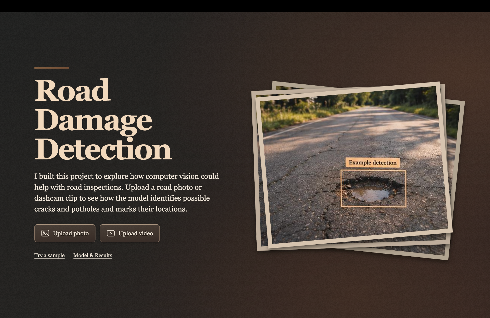
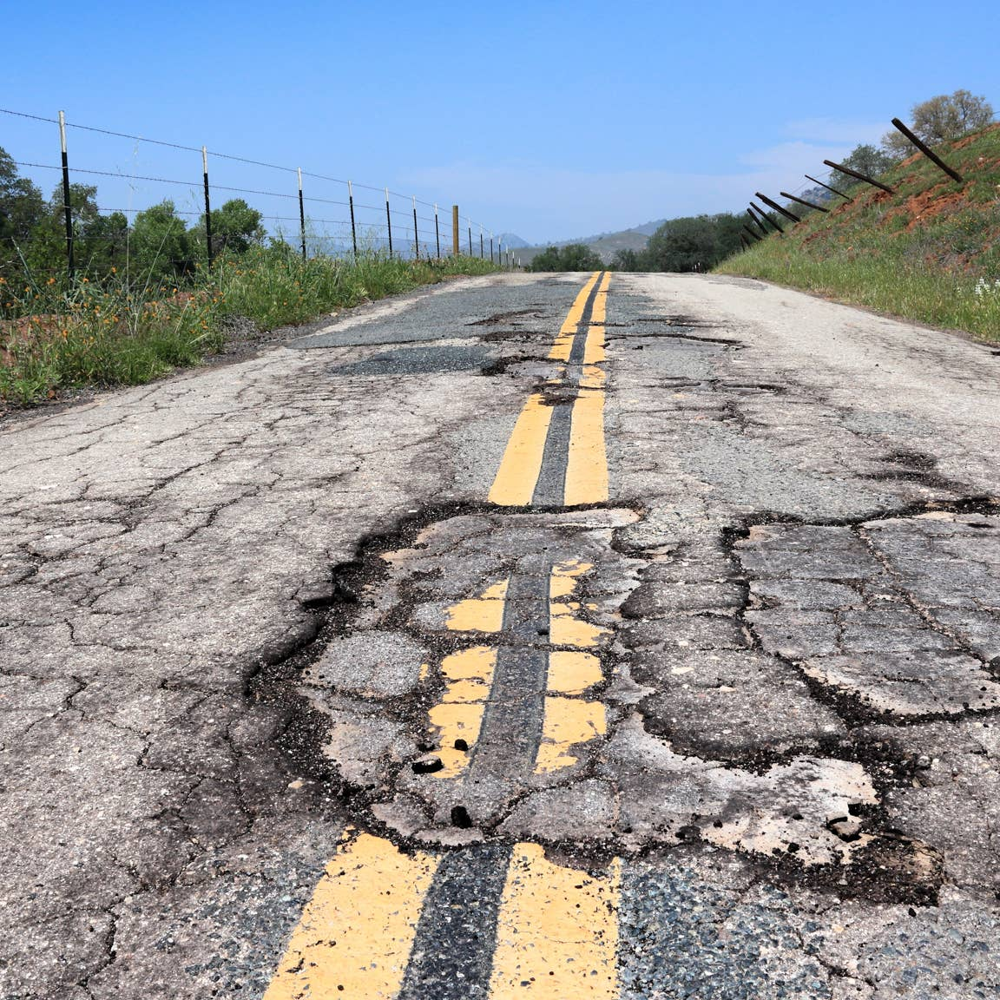
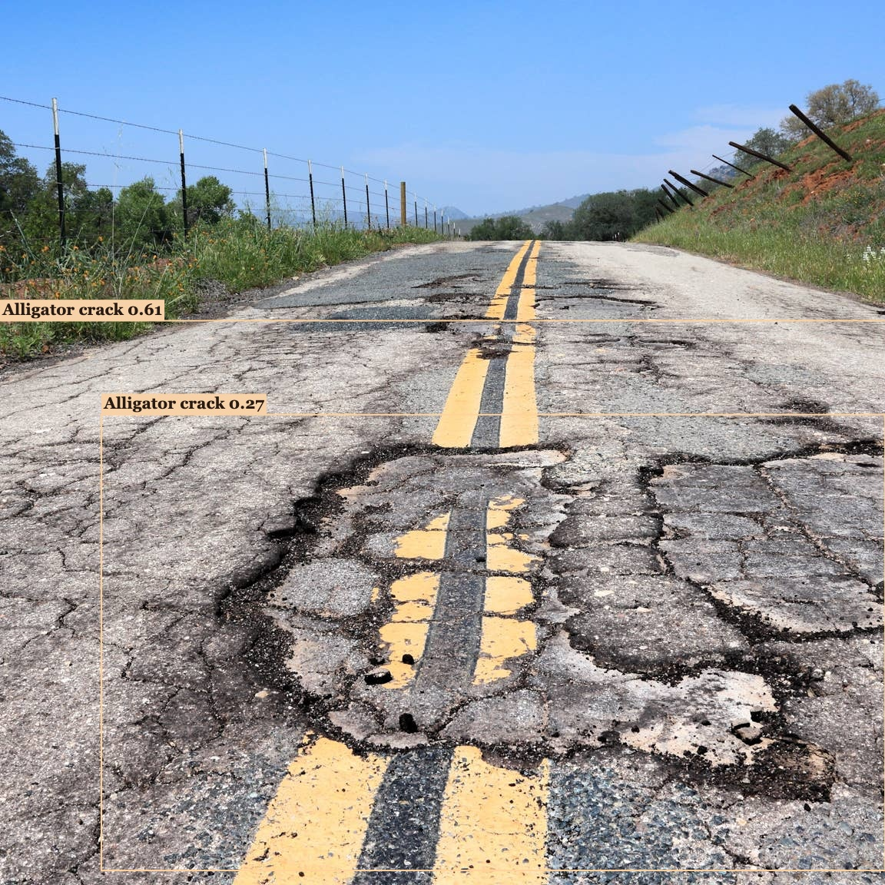
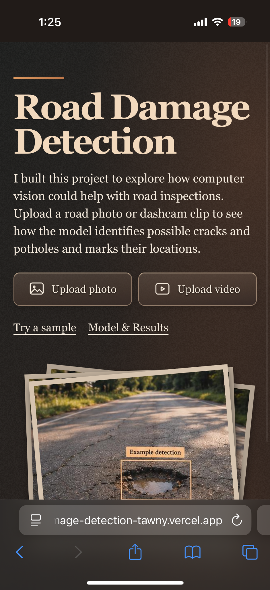

# Road Damage Detection

Upload a road photo and the app draws boxes around possible cracks and potholes. Upload a dashcam clip and you can jump to the moments where it spotted damage. I built it to explore whether computer vision could help someone reviewing road footage decide **where to look first**.

**[Live app](https://road-damage-detection-tawny.vercel.app/) · [Try a sample](https://road-damage-detection-tawny.vercel.app/samples/) · [Training notebook](notebooks/02_road_damage_training.ipynb)**

[](https://road-damage-detection-tawny.vercel.app/)

## Overview

I used **38,385 road images**, tested **eight approaches**, and built a web app that runs on a computer or phone. The biggest surprise came early: the same model scored **91.7% on one set of Chinese road images and 26.9% on Norwegian roads** using the same measure (validation mAP@50). Looking at the photos helped explain why some cracks were so easy to miss: a crack visible in the original could almost disappear when the image was made smaller.

That finding guided several experiments. In the end, I chose **YOLO26s**, the smaller of the two models I trained. The larger model placed boxes slightly better overall, but the smaller one was much faster. That mattered because the app has to check hundreds of images to review even a short video.

## Dataset and preparation

[RDD2022](https://doi.org/10.6084/m9.figshare.21431547.v1) includes road photos from India, Japan, Norway, the Czech Republic, the US, and China. China has separate drone and motorbike photos. I used the part of the dataset that came with marked examples of damage.

| What the model looks for | What it looks like |
| --- | --- |
| Longitudinal crack | A crack running along the road. |
| Transverse crack | A crack running across the road. |
| Alligator crack | Several cracks joining together like the scales on an alligator. |
| Pothole | A hole or depression in the road surface. |

1. **Check the markings.** I drew the supplied boxes on sample photos and checked that their corners fell inside the image. One box had invalid coordinates, so I skipped it. The four categories contained **55,006 usable boxes**. The mix varied: nearly half the marked defects in India were potholes, while about three quarters in Norway were longitudinal cracks.
2. **Convert the labels.** The original files described each box by its corners in pixels. YOLO needs its centre, width, and height relative to the picture. I [converted the labels](src/convert_to_yolo.py) into new files and kept the originals unchanged.
3. **Set aside images for a fair comparison.** I [split each collection](src/create_splits.py) into training, validation, and test images. The model learned from **30,704** images. I used **3,835** different images to compare ideas and kept the last **3,846** for the final test. The [inspection notebook](notebooks/01_dataset_inspection.ipynb) shows the checks and class counts.

## Model development: what I tried and why

I compared the experiments using **mAP@50–95**. This score rewards the model for finding the right kind of damage *and* drawing a box close to the marked location. Higher is better. A score of 31% does **not** mean 31% of road photos were correct.

| Experiment | What I tried and what happened | Validation mAP@50–95 |
| --- | --- | ---: |
| 1. Start small | I first trained on 1% of the data to check that the images, labels, and saved model worked. Then I trained YOLO26s on the full training set for 50 passes at an image size of 640 pixels. This gave me a starting score. | 31.55% |
| 2. Try a larger model | I trained YOLO26m at the same size for the same number of passes. It earned the highest score, but the gain over the small model was less than half a percentage point. | 32.04% |
| 3. Change how training photos are shown | Training sometimes combines several photos into one picture and changes their scale. I reduced both effects so thin cracks would stay easier to see. The small model scored slightly worse. | 30.8% |
| 4. Use fewer roads with no damage marked | I kept every training photo with marked damage and removed some of the others. The model found a slightly larger share of defects, but its overall score did not improve. | 31.3% |
| 5. Give the model closer views | I added 2,141 close-up crops from Norwegian training photos and adjusted their boxes. I still tested on whole photos. The best overall score stayed below the original; that score alone cannot tell us whether Norway improved. | 30.14% |
| 6. Use larger images | At 960 pixels, the original medium model scored 29.00%. Three more passes of training at that size raised it to 29.92%. That helped at 960, but the original still did better at 640. | 29.92% |
| 7. Give rarer damage more weight | I kept the first 11 parts of the medium model fixed and gave it a bigger penalty for mistakes on rarer classes. All four classes scored slightly lower. Since I changed two things together, I cannot say which caused the drop. | 31.66% |
| 8. Combine the two models | When both models marked the same kind of damage in the same area, I combined their boxes, giving the more confident one more weight. This helped in India and the Czech Republic but scored lower overall than either model alone. | 31.24% |

**Why try experiment 4?** In **11,720 of the 30,704 training photos (38.2%)**, no cracks or potholes were marked. Norway had many of these photos, and the model also missed a lot of damage there. I wanted to see whether the two were related. I reduced the share of photos with no damage marked to **7.54%**, leaving the validation and test photos unchanged. The share of labeled defects found rose from **54.8% to 56.6%**. One catch: with fewer photos, the model also got fewer chances to learn during each pass.

## Why I chose YOLO26s

On the same Tesla T4 GPU, the small model needed **8.7 milliseconds per image**, compared with **24.1** for the medium model. A one-minute clip gives the app about **240 frames to check**. For that task, I preferred the faster model over a gain of **0.49 percentage points** on validation. These are GPU measurements; a phone or laptop will run at its own speed.

## Final test results

Before opening the test set, I chose how confident the model had to be to show a box. On validation, raising the cutoff from **0.20 to 0.25** removed **543 false alarms**, but the share of marked defects found fell from **56.5% to 52.0%**. I used 0.25 as the default so reviewers would see fewer false alarms.

| On 3,846 held-out images | Result | What it means |
| --- | ---: | --- |
| mAP@50 | 60.06% | Scores the damage type and location, allowing a looser box match. |
| mAP@50–95 | 31.42% | Also checks progressively tighter box matches. |
| Precision at 0.25 | 69.32% | About 69 of every 100 boxes shown matched a marked defect. |
| Recall at 0.25 | 52.10% | About 52 of every 100 marked defects were found. |

The selected model found **2,908** marked defects, missed **2,674**, and produced **1,287** false alarms. These figures come from testing the trained Python model. The [full test report](results/test_metrics.json) includes results for each kind of damage.

## How the app works

I exported the trained model to **ONNX**, a format the browser can run. Vercel serves the website and model files. Your own photos and videos stay on your device.

- **Photo:** The app shrinks the picture to fit a 640-pixel square without stretching it, runs the model, then draws the boxes back on the original. Click a finding to highlight it, raise the confidence cutoff to hide weaker guesses, or download the marked picture.
- **Video:** The app checks four frames per second. Click a marker to jump to a stretch with possible damage. Supported browsers can also download a silent MP4 with the boxes drawn on it.
- **Samples:** The built-in examples have saved results so you can try the controls immediately. Choosing your own file runs a fresh check.

| Original road photo | Result downloaded from the app |
| :---: | :---: |
|  |  |

Here the model drew two overlapping boxes, scored **0.61** and **0.27**. At a cutoff of 0.50 only the first remains. Two boxes do not necessarily mean two separate defects.

<p align="center"></p>

## Project structure and tools

| Folder | What you’ll find |
| --- | --- |
| [notebooks/](notebooks/) | Dataset checks and the full training and experiment record. |
| [src/](src/) | Python scripts for preparing data, training with PyTorch and Ultralytics, and studying mistakes. |
| [results/](results/) | Saved test scores for the released model. |
| [road-damage-browser/](road-damage-browser/) | The deployed JavaScript app, ONNX model, video tools, and samples. |
| [road-damage-app/](road-damage-app/) | The earlier Python app. [Example outputs](outputs/) are also available. |

## Run locally


The browser version includes the exported model. From a terminal with Git and Python 3:

```bash
git clone https://github.com/Aaroh22/road-damage-detection.git
cd road-damage-detection
python3 -m http.server 8000 --directory road-damage-browser
```

Open [localhost:8000](http://localhost:8000/). No Python packages, GPU, or dataset download are needed for the demo.

<details>
<summary><strong>Reproduce the test evaluation or train the baseline</strong></summary>

In a new terminal at the repository root, create a Python environment (macOS/Linux):

```bash
python3 -m venv .venv
source .venv/bin/activate
python -m pip install "ultralytics==8.4.204" pyyaml pillow
```

Download [RDD2022](https://doi.org/10.6084/m9.figshare.21431547.v1) and unpack the seven domain folders under `data/raw/RDD2022/`. Each domain should contain `train/images/` and `train/annotations/xmls/`. Then run:

```bash
python src/convert_to_yolo.py
python src/create_splits.py
python -c "from src.train import prepare_data_yaml; prepare_data_yaml()"
```

Check that the printed split counts match the counts above. The split script will stop if a split already exists. To reproduce the two mAP values without retraining, download the [released checkpoint](https://github.com/Aaroh22/road-damage-detection/releases/tag/model-v1.0) and evaluate it:

```bash
curl -fL https://github.com/Aaroh22/road-damage-detection/releases/download/model-v1.0/road_damage_yolo26s.pt -o road_damage_yolo26s.pt
yolo detect val model=road_damage_yolo26s.pt data=data_temp.yaml split=test \
  imgsz=640 batch=8 device=0 conf=0.001 iou=0.7 max_det=300 \
  nms=True rect=True half=False augment=False
```

`device=0` selects an NVIDIA GPU with CUDA-enabled PyTorch; use `device=cpu` for a slower evaluation. The low confidence cutoff retains predictions for the mAP calculation. The final evaluation cell in the [training notebook](notebooks/02_road_damage_training.ipynb) separately counts matches at the demo threshold of 0.25.

To train the selected baseline from pretrained weights instead, run `python src/train.py` with a CUDA GPU. The notebook records the original Colab runs; historical cells are disabled and some expect saved Drive checkpoints. The [training and evaluation scripts](src/) are the local entry points.

</details>

## Limitations and next steps

A road with no boxes may still be damaged. Thin cracks can disappear when an image is reduced in size, and a brief defect in a video can fall between the frames the app checks. A box shows where to look; it does not measure a pothole’s depth or tell an inspector which repair is urgent.

The test images came from the same collections as the training images. They do not show how well the model handles a completely new country or camera. My next test would keep entire drives together and evaluate on roads the model has never seen. I would also compare the Python and browser versions on the same labeled photos to measure whether their predictions differ after export.

## What I learned

The most useful habit I picked up was **looking at the mistakes before deciding what to change**. Seeing a real crack disappear after resizing gave me a better experiment to run than simply training a larger model.

I also learned to ask **“better compared with what?”** Training at 960 pixels improved the model compared with its own starting point, yet still lost to the original at 640. And building the video app changed how I judged the winner: a small gain in box quality was less valuable here than time saved on every frame.
